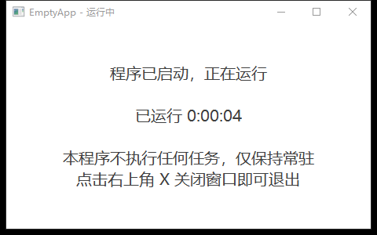

# [赤石coding]应用（并不能用）程序

**EmptyApp v1.14.514震撼发布！**

成功实现了工程达到了零 的突破！

全文仅供5次会话，100%vibecoding，10workbuddy积分诞生！

## 功能简介：

1.
2.
3.

## 操作流程：

1. 睁开眼睛，移动惯用手按动机箱开关；
2. 使用食指点击鼠标，双击exe文件；
3. 打开文件并执行；
4. 想关的时候把鼠标移动至X键，点击一下以关闭程序。

## 特别感谢：

我的脑子，让我想出这个神人想法；

我的眼睛，让我看见屏幕用于vibecoding；

我的右手，参与了程序（对话）50%的任务；

我的左手，参与了打字50%的任务；

我的拖鞋，尬到扣出三百室一百厅还没有破洞。

本程序使用MIT协议进行开源

等我哪天想起来了我再回来看看，update时间看我心情

---

> 技术说明、构建方法与安全审计见 [README.tech.md](README.tech.md)。
