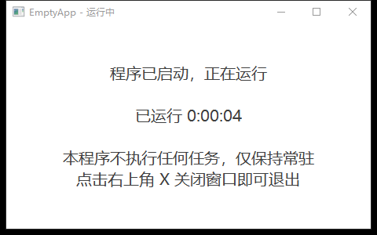

# EmptyApp

> 这是**技术说明版**。项目首页（趣味版）见 [README.md](README.md)。

一个**什么都不做**的 Windows 窗口程序：打开、常驻、关掉。仅此而已。

没有按钮、没有菜单、没有业务逻辑，也不联网。存在的意义是当作一个空白宿主 ——
用于占位测试、进程存活验证、窗口行为演示，或者只是需要一个"能跑起来的最小 exe"。



## 特性

- **真·单文件**：74 KB，纯 Win32 API，双击即开
- **零运行时依赖**：不需要 .NET / Python / VC++ 运行库，Windows 自带 DLL 即可
- **启动快**：从双击到窗口出现约 0.1 秒
- **不依赖临时目录**：不自我解压，不会出现 `Could not create temporary directory!`
- **静态极简**：不联网、不读写文件、不写注册表、不创建子进程（见下方审计结果）
- **可交叉编译**：在 Linux / macOS 上用 zig 也能产出 .exe

## 快速开始

从 [Releases](../../releases) 下载 `EmptyApp.exe`，双击运行。关闭窗口即退出。

## 从源码构建

### 1. 安装 zig 编译器

任选其一：

```bash
winget install zig.zig          # Windows
pip install ziglang             # 已有 Python 时最省事
```

### 2. 编译

```bat
build.bat
```

产物：`dist\EmptyApp.exe`。

也可以手动执行（Windows / Linux / macOS 通用，`zig cc` 本身即可交叉编译）：

```bash
zig cc -target x86_64-windows-gnu -O2 -DUNICODE -D_UNICODE \
       -Wl,--subsystem,windows -s \
       -o dist/EmptyApp.exe app.c -luser32 -lgdi32
```

> **三个必须注意的点**
>
> 1. `-DUNICODE` 不能省，否则 `IDC_ARROW` 会展开成 ANSI 版，`LoadCursorW` 类型不匹配、直接编译报错。
> 2. 必须用 `-Wl,--subsystem,windows` 指定 GUI 子系统。`zig cc` 的 `-mwindows` 参数**不生效**（只给一条 warning），产出的仍是 console 版，双击会多一个黑框。
> 3. `app.c` 是 UTF-8 编码（含中文文案），不要用 GBK 另存。

## 系统要求

Windows 10 / 11（x64）。

程序链接了 UCRT（`api-ms-win-crt-*`），Win10 起系统自带。若需要在 Windows 7 上运行，
需先安装 [KB2999226](https://support.microsoft.com/help/2999226)。

## 项目结构

```
README.md             项目首页（趣味版）
README.tech.md        本文件：技术说明、构建、审计
app.c                 全部源码，约 130 行
build.bat             构建脚本（自动探测 zig 或 python -m ziglang）
tools/verify.py       功能验证：窗口出现 / 持续运行 / CPU / 关闭 / 自动截图
tools/test_tmp.py     环境容错：在 %TEMP% 失效时仍能启动
tools/audit_exe.py    PE 静态审计：导入表、网络能力、密钥特征扫描
docs/screenshot.png   README 截图，由 verify.py 生成
```

运行验证（需先构建）：

```bash
python tools/verify.py
python tools/test_tmp.py
python tools/audit_exe.py
```

## 安全说明

对 `EmptyApp.exe` 的静态审计结果（可用 `tools/audit_exe.py` 复现）：

| 项目 | 结果 |
|---|---|
| 导入 DLL | 仅 `USER32` / `GDI32` / `KERNEL32` + UCRT |
| 网络 API | 无（无 `socket` / `wininet` / `winhttp` / `ws2_32`） |
| 动态加载 | 无 `LoadLibrary` / `GetProcAddress` —— 无法在运行时偷偷加载网络库 |
| 文件 / 注册表 | 无 `CreateFile` / `WriteFile` / `RegOpenKey` |
| 进程创建 | 无 `CreateProcess` / `ShellExecute` |
| 密钥 / 令牌 | 0 处命中 |
| 运行时网络连接 | 实测 0 条 |

程序不含任何 API Key、账号信息或遥测。

> 附注：本仓库不提交编译产物，`dist/` 已在 `.gitignore` 中忽略。
> 由于未经代码签名，首次运行可能触发 SmartScreen 提示，选择"仍要运行"即可。

## 许可

[MIT](LICENSE)
